# Earth Jukebox

**English** · [Українська](README.uk.md)

**Hear the planet NASA shows us.** Earth Jukebox turns a NASA aerosol visualization and the live weather of the whole planet into music you can explore by ear. It is built for blind and low-vision listeners first, and for anyone who understands data better by listening. Made for the NASA Space Apps Challenge 2026 challenge [The Earth Information Jukebox](https://www.spaceappschallenge.org/2026/challenges/the-earth-information-jukebox/).


*Four aerosols* plays the NASA SVS 5669 frame from west to east. Black carbon, dust, sea salt and sulfate each get an instrument. Higher notes sit further north, louder means more of the map, and the caption says what you hear right now.

🎧 **Listen first:** [Four aerosols](docs/audio/four-aerosols.mp3) · [Gentle scale](docs/audio/gentle-scale.mp3) · [Rain right now](docs/audio/rain-right-now.mp3) (MP3, about a minute each, [what you hear](docs/audio/README.md))

## What you can do

| Hear today's weather | Every layer sounds different |
|---|---|
| 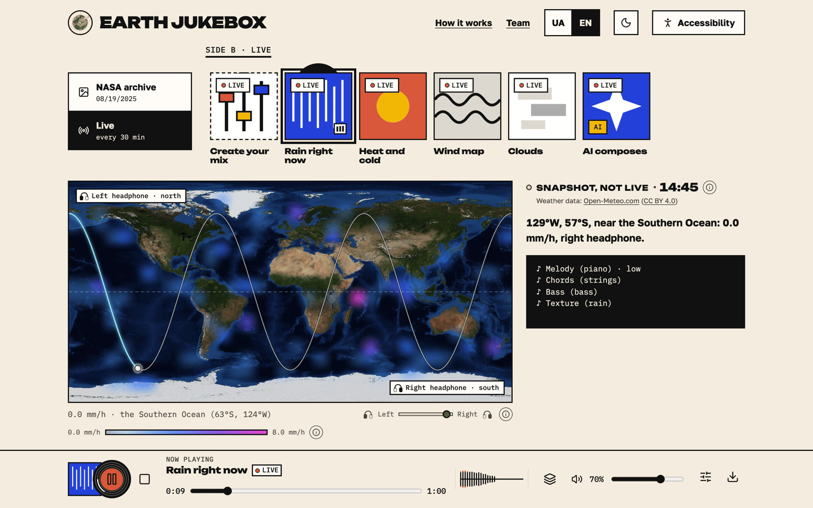 | 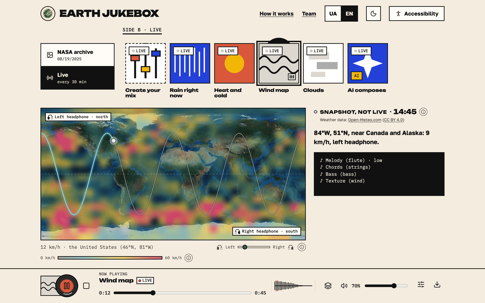 |
| **Rain right now** sends a wave across the planet and plays the rain under it. The north sounds in your left ear, the south in your right. A new reading comes every 30 minutes. | Temperature, rain, clouds and wind each have their own key, tempo and instruments. Stronger wind plays a faster rhythm, more rain plays denser arpeggios. |
| **Explore any spot** | **Create your own mix** |
| 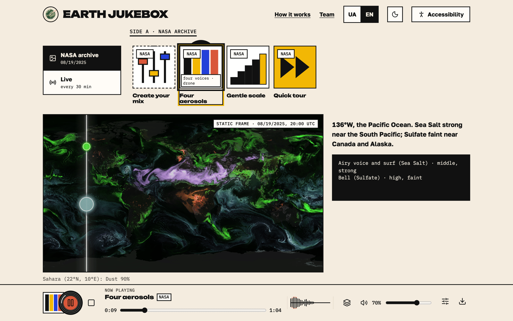 | 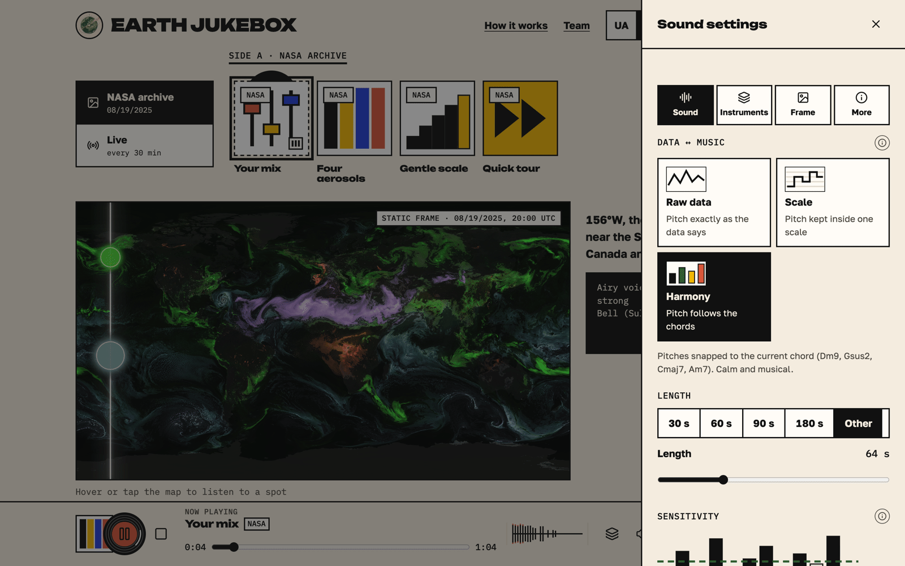 |
| Hover, tap or use the arrow keys on the map to hear one place and have it read out, for example *"Sahara (22°N, 10°E): Dust 90%"*. | Pick raw data, a scale or chords, the length and how faint a layer may be and still sound. The music follows at once. |
| **Control every voice** | **Save what you hear** |
| 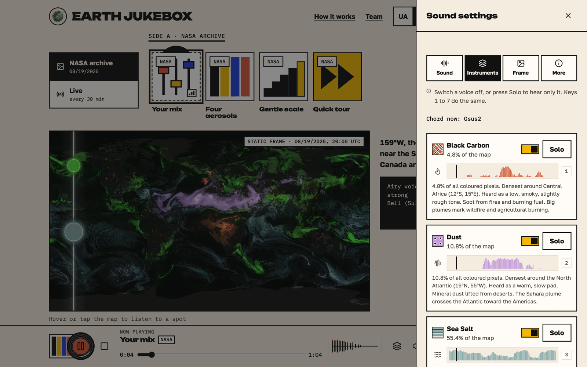 | 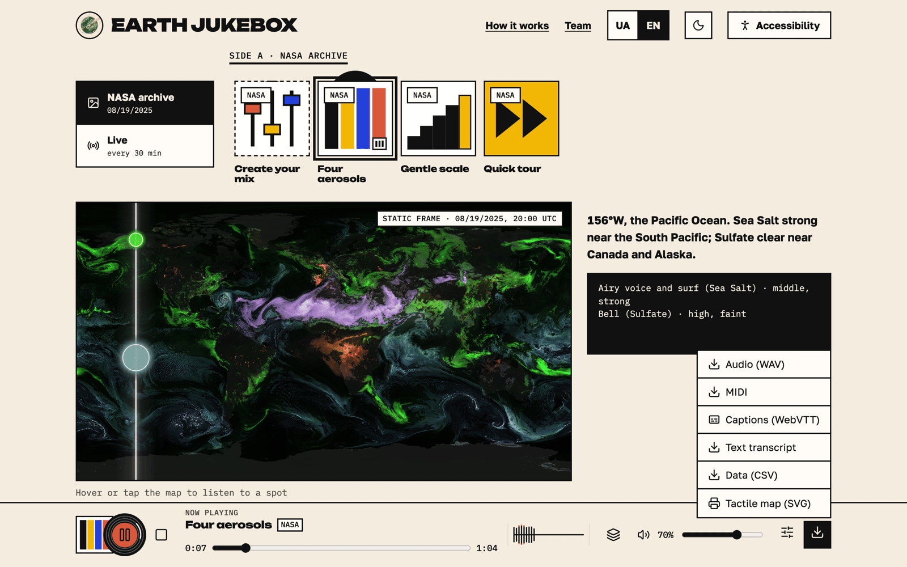 |
| Switch a voice off, solo it, and see where it sits on the map. Keys 1–7 do the same. | Audio (WAV), MIDI, captions (WebVTT), a text transcript, the data as CSV and a tactile map (SVG) to print. |
| **Accessibility in one click** | **Large text and high contrast** |
| 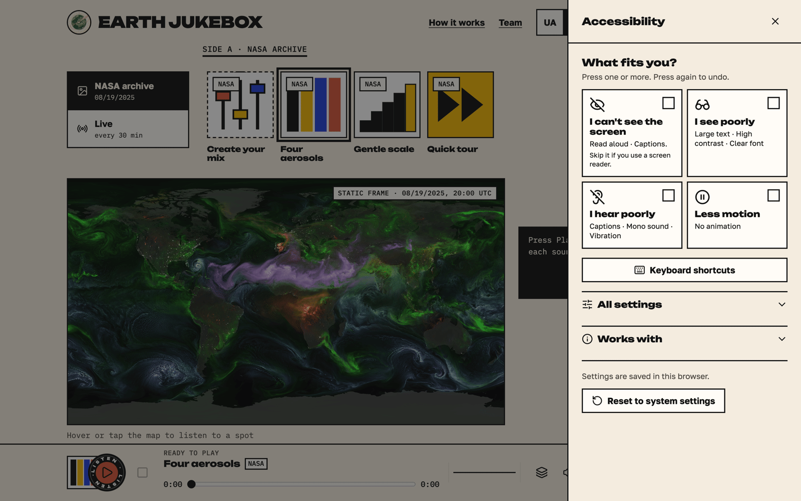 | 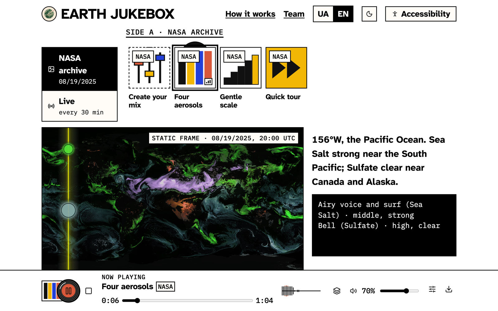 |
| Choose what fits you. Each choice turns on a set of settings: narration, captions, large text, high contrast, mono sound, vibration, no animation. | "I see poorly" makes text bigger, switches to a clear font and raises contrast. |
| **Keyboard first** | **Light or dark** |
| 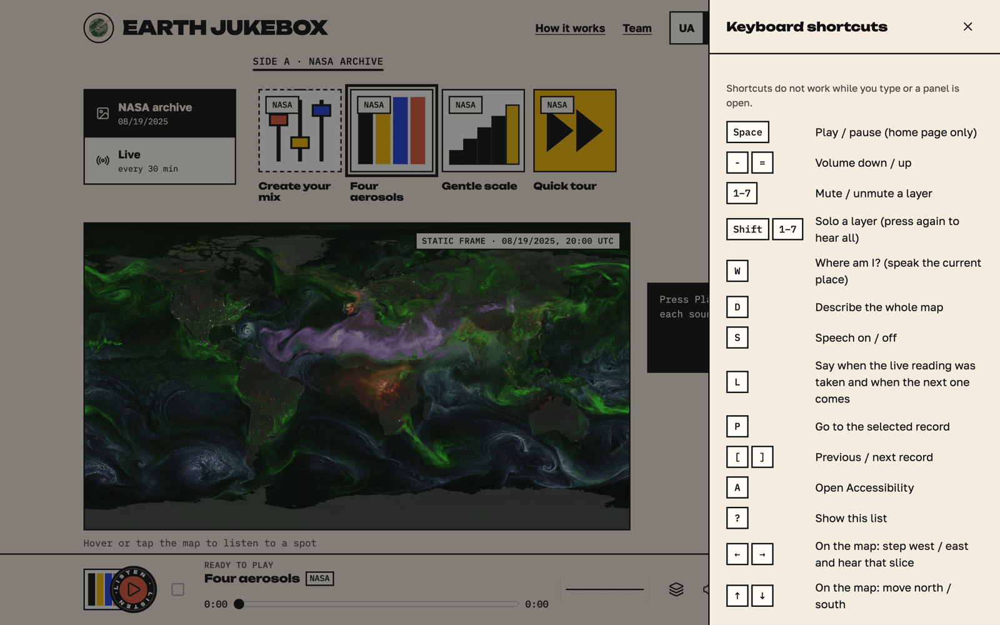 | 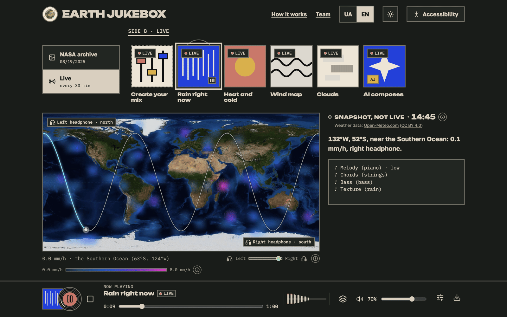 |
| Everything works from the keyboard. Press `?` for the full list: play, describe the map, where am I, step through the map. | A dark theme for night listening. Colour-blind palettes are in the settings. |
| **Learn how it works** | **On a phone** |
| 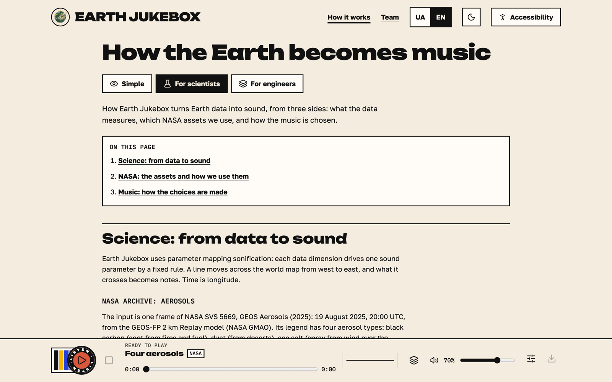 | 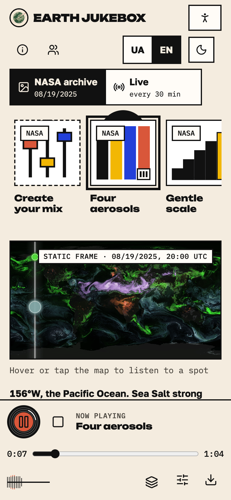 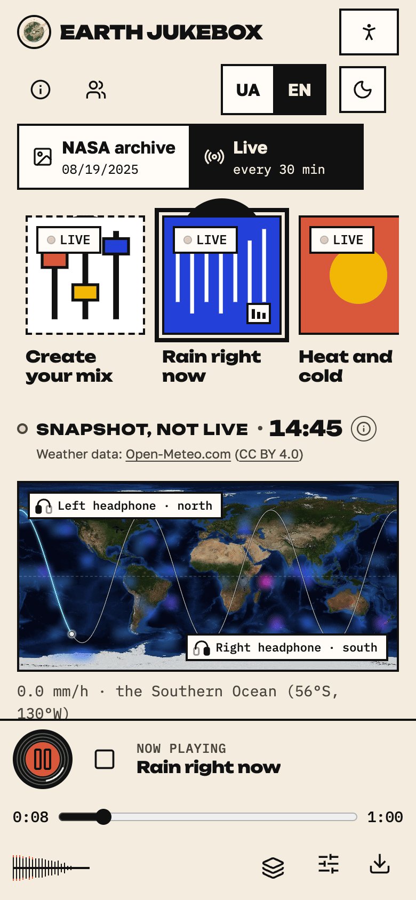 |
| Three levels: [simple](docs/screenshots/en/how-simple.png), for scientists, and [for engineers](docs/screenshots/en/how-engineers.png). | The same app on a small screen, with touch exploration of the map. |

All screenshots in both languages: [docs/screenshots](docs/screenshots/README.md).

## Records

| Side | Records |
|---|---|
| NASA archive | Create your mix · Four aerosols · Gentle scale · Quick tour |
| Live | Create your mix · Rain right now · Heat and cold · Wind map · Clouds · AI composes |

## Quick start

You need Git and Docker.

```bash
git clone https://github.com/dankozz1t/nasa-earth-jukebox.git
cd nasa-earth-jukebox
scripts/start.sh        # Windows PowerShell: .\scripts\start.ps1
```

Open <http://localhost:5180> and click a record. The first build takes a few minutes. No keys or settings are needed; [.env.example](.env.example) lists the optional ones. Running each part by hand, tests and troubleshooting: [docs/development.md](docs/development.md).

## How it works

- A line moves across the world map from west to east, so time is longitude.
- **NASA archive:** each pixel of the frame is sorted into one of four aerosol layers by colour. The area a layer covers becomes loudness, its latitude becomes pitch.
- **Live:** the weather under a sine wave becomes a score for 6–7 instruments, written by rules or, optionally, by AI. Loudness always follows the data.
- One audio stem per instrument, played in sync in the browser.

Details: [docs/sound-mapping.md](docs/sound-mapping.md).

## Data

- **NASA Scientific Visualization Studio, [SVS 5669](https://svs.gsfc.nasa.gov/5669/) "GEOS Aerosols (2025)"**, from the Earth Information Center collection: the frame of 19 August 2025, 20:00 UTC (GEOS-FP 2 km Replay, NASA GMAO). It is the whole NASA archive side.
- **NASA GIBS**, Blue Marble Shaded Relief and Bathymetry: the basemap under the live weather.
- **Open-Meteo**: current temperature, precipitation, cloud cover and wind on a 10° grid. It drives the Live side and is labelled separately from NASA data.

More: [docs/data-sources.md](docs/data-sources.md).

## Use of AI

- **In the app (optional):** on the Live side, a Claude model can write the score as JSON from the weather values. It never makes audio and never touches the NASA side. It needs your own key, every AI score is checked before it plays, and spend limits apply.
- **Building it:** Claude Code helped write code, tests and documentation. The sound design, the musical rules and the architecture are ours.

More: [docs/ai.md](docs/ai.md).

## Project structure

```
frontend/        React + TypeScript web app, audio player, accessibility
backend/         C# ASP.NET Core API in front of the sound service
sound-service/   Python service that turns images and weather into music
docs/            documentation, screenshots, audio samples
scripts/         start, stop, logs, dev, test
compose.yaml     runs the three services together
```

How the parts fit: [docs/architecture.md](docs/architecture.md).

## Documentation

| Page | About |
|---|---|
| [architecture.md](docs/architecture.md) | The three services and how a request flows |
| [sound-mapping.md](docs/sound-mapping.md) | How pixels and weather become music |
| [data-sources.md](docs/data-sources.md) | NASA and Open-Meteo data, attribution, limits of the method |
| [accessibility.md](docs/accessibility.md) | Features for blind, low-vision, deaf and other users |
| [api.md](docs/api.md) | Public HTTP API |
| [ai.md](docs/ai.md) | The optional AI composer and AI tools used |
| [development.md](docs/development.md) | Running, testing and troubleshooting |
| [deployment.md](docs/deployment.md) | Publishing to Google Cloud Run |

## Credits

- NASA Scientific Visualization Studio and NASA GMAO for [SVS 5669](https://svs.gsfc.nasa.gov/5669/). Notice: [sound-service/NOTICE.md](sound-service/NOTICE.md).
- We acknowledge the use of imagery provided by services from NASA's Global Imagery Browse Services (GIBS), part of NASA's Earth Science Data and Information System (ESDIS).
- Weather data by [Open-Meteo.com](https://open-meteo.com/), [CC BY 4.0](https://creativecommons.org/licenses/by/4.0/).
- Fonts: Golos Text, Unbounded, IBM Plex Mono, Atkinson Hyperlegible Next (SIL Open Font License 1.1). Icons: Lucide (ISC).
