# Earth Jukebox

[English](README.md) · **Українська**

**Почуйте планету, яку показує NASA.** Earth Jukebox перетворює візуалізацію аерозолів NASA і погоду всієї планети просто зараз на музику, яку можна досліджувати на слух. Застосунок зроблено насамперед для незрячих і слабозорих людей, а також для всіх, кому легше зрозуміти дані через звук. Створено для NASA Space Apps Challenge 2026, челендж [The Earth Information Jukebox](https://www.spaceappschallenge.org/2026/challenges/the-earth-information-jukebox/).

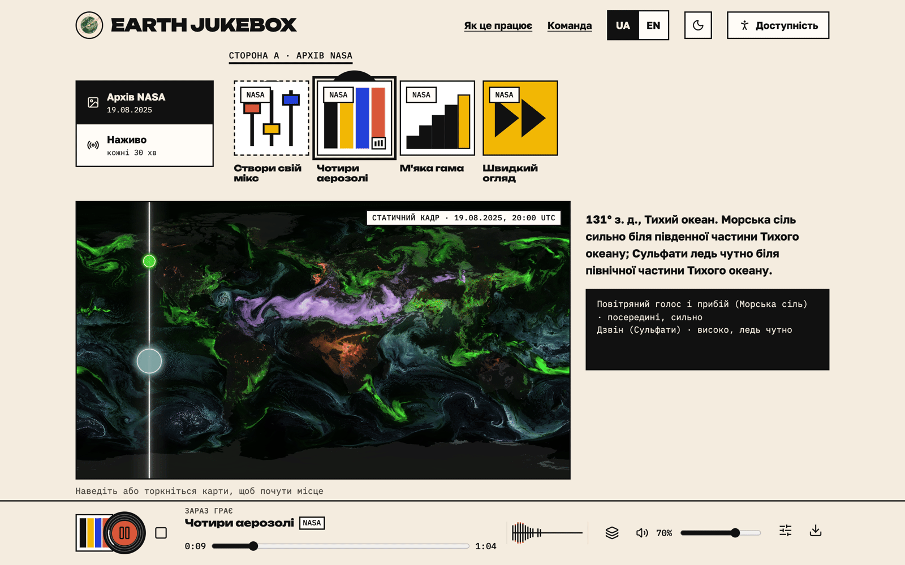

*Чотири аерозолі* грає кадр NASA SVS 5669 із заходу на схід. Сажа, пил, морська сіль і сульфати мають кожен свій інструмент. Вищі ноти означають північніше, гучніше означає більшу частку карти, а підпис каже, що звучить просто зараз.

🎧 **Спершу послухайте:** [Чотири аерозолі](docs/audio/four-aerosols.mp3) · [М'яка гама](docs/audio/gentle-scale.mp3) · [Дощ зараз](docs/audio/rain-right-now.mp3) (MP3, близько хвилини кожен, [що звучить](docs/audio/README.md), англійською)

## Що можна робити

| Почути погоду просто зараз | Кожен шар звучить по-своєму |
|---|---|
| 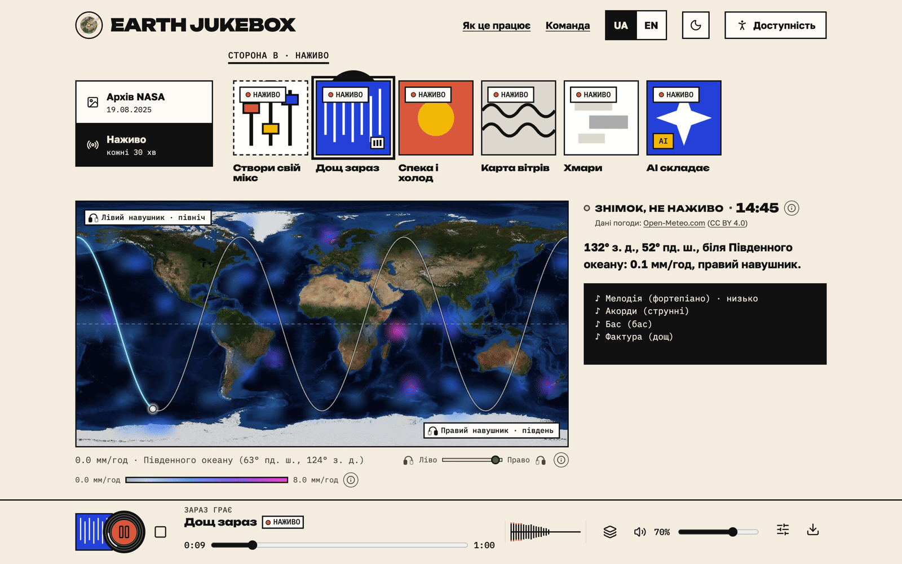 | 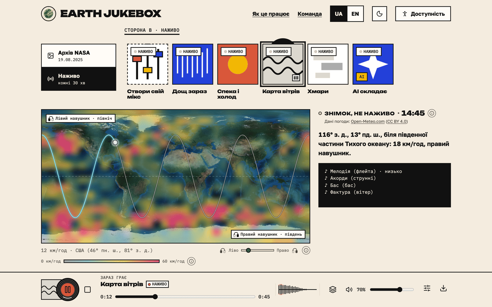 |
| **Дощ зараз** проводить хвилю через планету і грає дощ під нею. Північ звучить у лівому навушнику, південь у правому. Новий замір приходить кожні 30 хвилин. | Температура, дощ, хмари і вітер мають свою тональність, темп та інструменти. Сильніший вітер грає швидший ритм, більше дощу грає густіші арпеджіо. |
| **Послухати будь-яке місце** | **Створи свій мікс** |
|  | 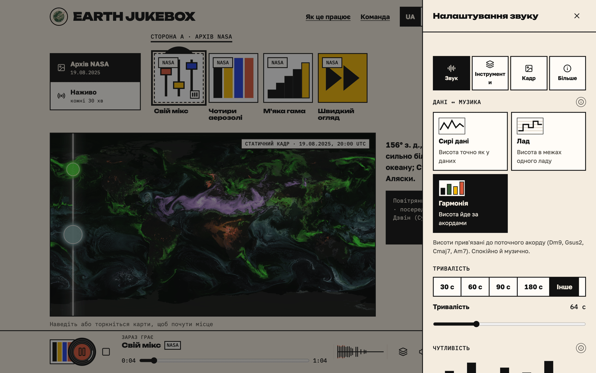 |
| Наведіть мишу, торкніться або рухайтеся стрілками по карті, щоб почути одне місце, його назву, координати і значення, наприклад частку пилу над Сахарою. | Оберіть сирі дані, гаму чи акорди, тривалість і те, наскільки слабкий шар ще звучить. Музика змінюється одразу. |
| **Кожен голос під контролем** | **Збережіть почуте** |
| 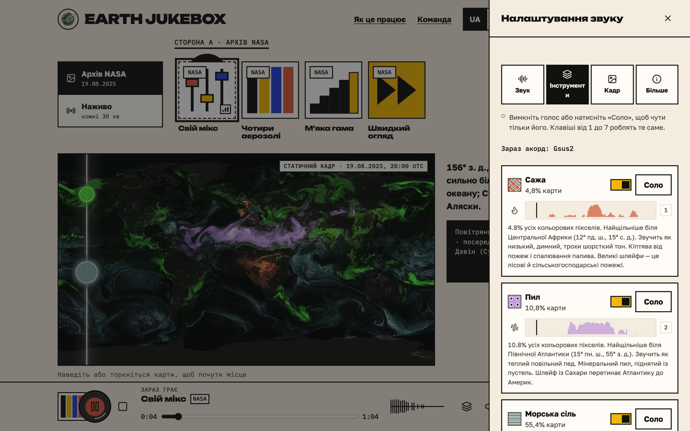 | 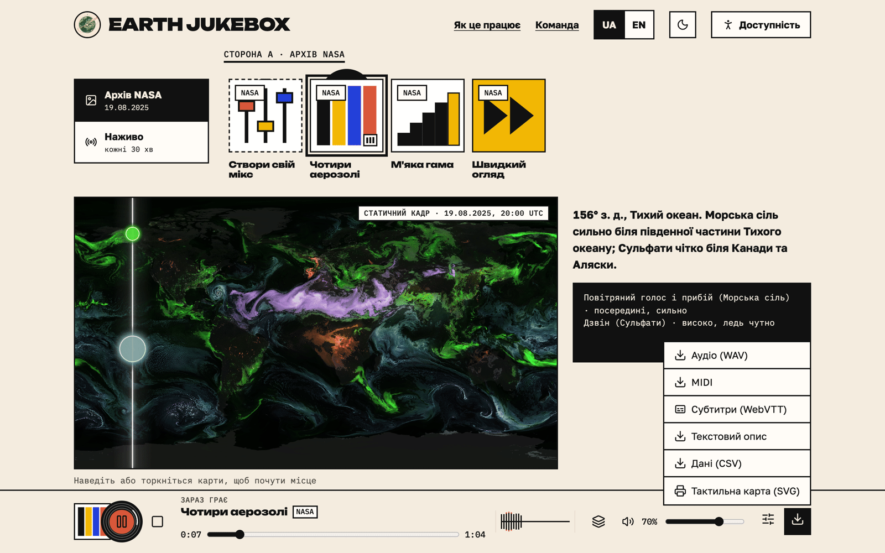 |
| Вимкніть голос, залиште тільки його і подивіться, де він на карті. Клавіші 1–7 роблять те саме. | Аудіо (WAV), MIDI, субтитри (WebVTT), текстовий опис, дані у CSV і тактильна карта (SVG) для друку. |
| **Доступність одним кліком** | **Великий текст і висока контрастність** |
| 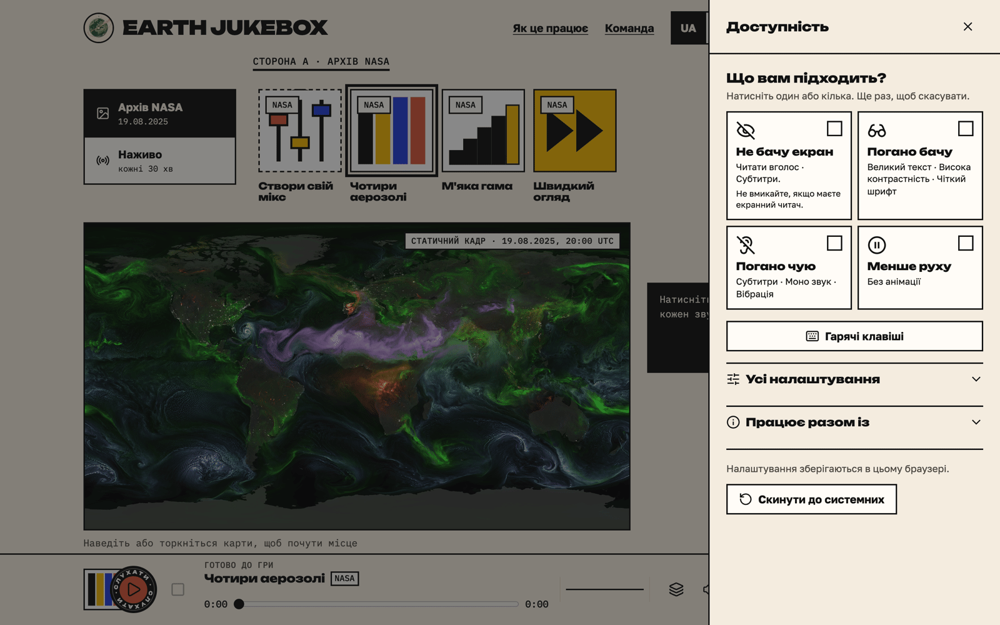 | 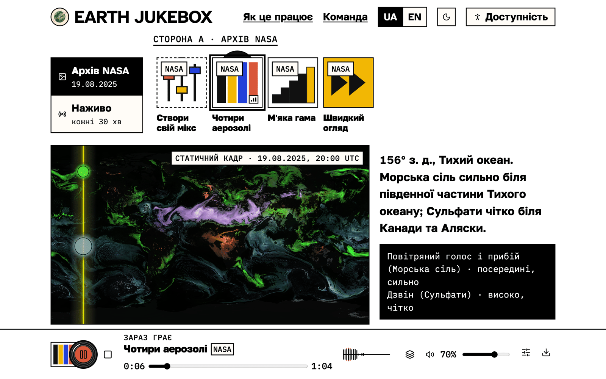 |
| Оберіть, що вам підходить. Кожен вибір вмикає набір налаштувань: озвучення, субтитри, великий текст, висока контрастність, моно звук, вібрація, без анімації. | «Погано бачу» збільшує текст, вмикає чіткий шрифт і підвищує контрастність. |
| **Усе з клавіатури** | **Світла чи темна** |
| 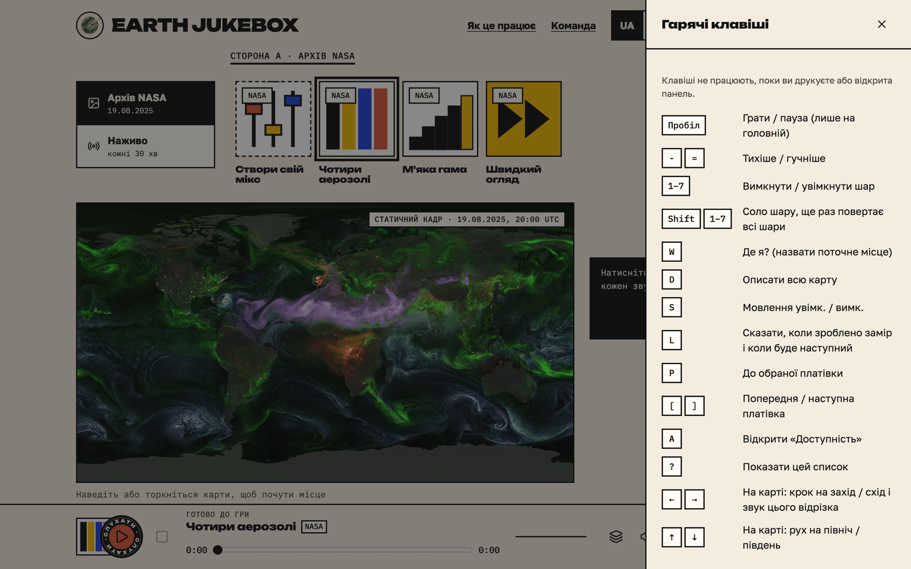 | 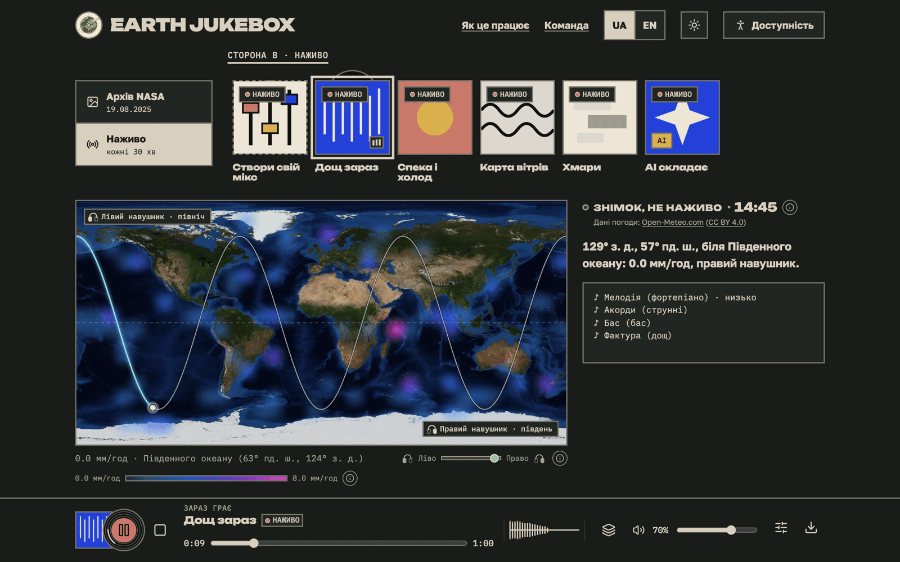 |
| Усім можна керувати з клавіатури. Клавіша `?` показує повний список: грати, описати карту, де я, крок картою. | Темна тема для слухання вночі. Палітри для дальтоніків є в налаштуваннях. |
| **Зрозуміти, як це працює** | **На телефоні** |
| 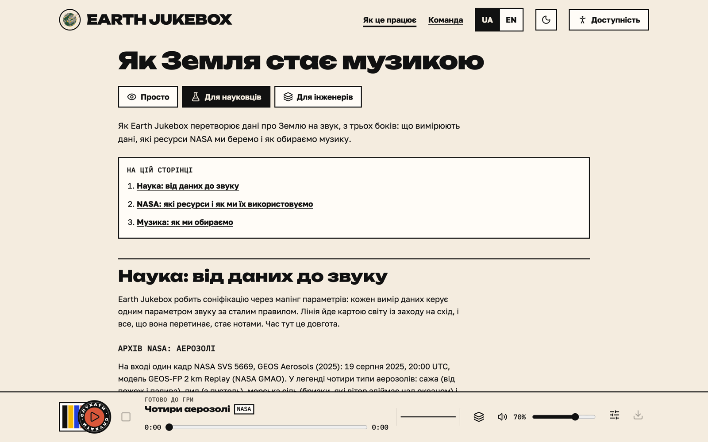 | 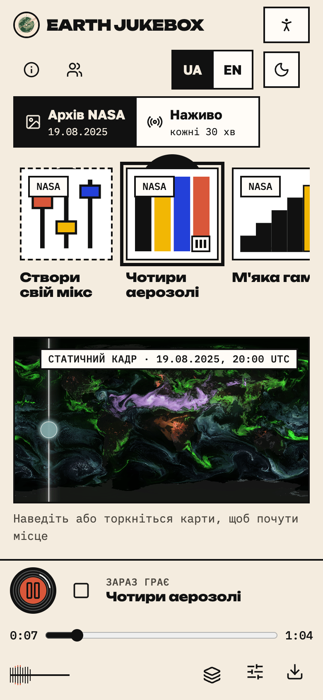 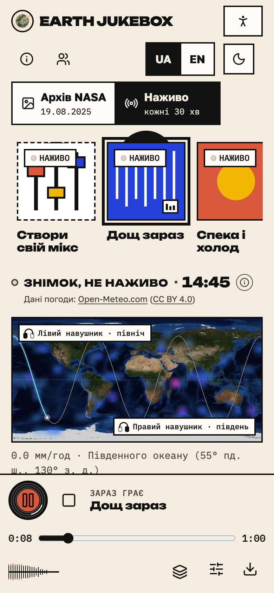 |
| Три рівні: [просто](docs/screenshots/uk/how-simple.png), для науковців і [для інженерів](docs/screenshots/uk/how-engineers.png). | Той самий застосунок на маленькому екрані, карту можна досліджувати дотиком. |

Усі скриншоти обома мовами: [docs/screenshots](docs/screenshots/README.md).

## Платівки

| Бік | Платівки |
|---|---|
| Архів NASA | Створи свій мікс · Чотири аерозолі · М'яка гама · Швидкий огляд |
| Наживо | Створи свій мікс · Дощ зараз · Спека і холод · Карта вітрів · Хмари · AI складає |

## Швидкий старт

Потрібні Git і Docker.

```bash
git clone https://github.com/dankozz1t/nasa-earth-jukebox.git
cd nasa-earth-jukebox
scripts/start.sh        # Windows PowerShell: .\scripts\start.ps1
```

Відкрийте <http://localhost:5180> і натисніть платівку. Перша збірка триває кілька хвилин. Ключі й налаштування не потрібні, необов'язкові перелічені в [.env.example](.env.example). Як запустити кожну частину окремо, тести і розв'язання проблем: [docs/development.md](docs/development.md) (англійською).

## Як це працює

- Лінія рухається картою світу із заходу на схід, тож час це довгота.
- **Архів NASA:** кожен піксель кадру за кольором потрапляє в один із чотирьох шарів аерозолів. Частка карти, яку займає шар, стає гучністю, його широта стає висотою звуку.
- **Наживо:** погода під синусоїдою стає партитурою для 6–7 інструментів. Її пишуть правила або, за бажанням, AI. Гучність завжди йде за даними.
- Для кожного інструмента окремий аудіотрек, браузер грає їх синхронно.

Детально: [docs/sound-mapping.md](docs/sound-mapping.md) (англійською).

## Дані

- **NASA Scientific Visualization Studio, [SVS 5669](https://svs.gsfc.nasa.gov/5669/) «GEOS Aerosols (2025)»** з колекції Earth Information Center: кадр 19 серпня 2025, 20:00 UTC (GEOS-FP 2 km Replay, NASA GMAO). Це весь бік «Архів NASA».
- **NASA GIBS**, Blue Marble Shaded Relief and Bathymetry: карта під живою погодою.
- **Open-Meteo**: поточні температура, опади, хмарність і вітер на сітці 10°. Живить бік «Наживо» і підписаний окремо від даних NASA.

Більше: [docs/data-sources.md](docs/data-sources.md) (англійською).

## Використання AI

- **У застосунку (необов'язково):** на боці «Наживо» модель Claude може написати партитуру у форматі JSON за значеннями погоди. Вона ніколи не створює звук і не торкається боку NASA. Потрібен ваш власний ключ, кожна партитура AI перевіряється перед відтворенням, діють ліміти витрат.
- **Під час розробки:** Claude Code допомагав писати код, тести й документацію. Звуковий дизайн, музичні правила й архітектура наші.

Більше: [docs/ai.md](docs/ai.md) (англійською).

## Структура проєкту

```
frontend/        вебзастосунок на React + TypeScript, програвач, доступність
backend/         API на C# ASP.NET Core перед звуковим сервісом
sound-service/   сервіс на Python, що перетворює зображення й погоду на музику
docs/            документація, скриншоти, аудіоприклади
scripts/         start, stop, logs, dev, test
compose.yaml     запускає три сервіси разом
```

Як частини працюють разом: [docs/architecture.md](docs/architecture.md) (англійською).

## Документація

Уся документація англійською.

| Сторінка | Про що |
|---|---|
| [architecture.md](docs/architecture.md) | Три сервіси і шлях запиту |
| [sound-mapping.md](docs/sound-mapping.md) | Як пікселі й погода стають музикою |
| [data-sources.md](docs/data-sources.md) | Дані NASA і Open-Meteo, атрибуція, межі методу |
| [accessibility.md](docs/accessibility.md) | Можливості для незрячих, слабозорих, людей із порушеннями слуху та інших |
| [api.md](docs/api.md) | Публічний HTTP API |
| [ai.md](docs/ai.md) | Необов'язковий AI-композитор і AI-інструменти розробки |
| [development.md](docs/development.md) | Запуск, тести, розв'язання проблем |
| [deployment.md](docs/deployment.md) | Публікація на безкоштовний Hugging Face Space |

## Подяки

- NASA Scientific Visualization Studio і NASA GMAO за [SVS 5669](https://svs.gsfc.nasa.gov/5669/). Примітка: [sound-service/NOTICE.md](sound-service/NOTICE.md).
- We acknowledge the use of imagery provided by services from NASA's Global Imagery Browse Services (GIBS), part of NASA's Earth Science Data and Information System (ESDIS).
- Дані погоди: [Open-Meteo.com](https://open-meteo.com/), [CC BY 4.0](https://creativecommons.org/licenses/by/4.0/).
- Шрифти: Golos Text, Unbounded, IBM Plex Mono, Atkinson Hyperlegible Next (SIL Open Font License 1.1). Іконки: Lucide (ISC).
