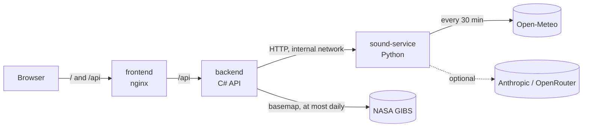

# Architecture

Three services, each in its own folder at the repository root, started together by [compose.yaml](../compose.yaml) (`scripts/start.sh`, see the [Quick start](../README.md#quick-start)).

| Service | Stack | Port | Job |
|---|---|---|---|
| [frontend](../frontend/) | React 19, Vite, TypeScript, Web Audio, nginx | 5180 (Docker), 5173 (dev) | The jukebox UI: presets, map, stem player, mouse and keyboard exploration, accessibility. Plays the stems it gets. |
| [backend](../backend/) | C#, ASP.NET Core, .NET 10 | 8080 | The only public API: NASA frame catalog, validation, rate limit, proxy to the sound service, NASA GIBS basemap. |
| [sound-service](../sound-service/) | Python 3.12+, FastAPI, NumPy, Pillow, mido | 8000 (internal) | Makes the sound: NASA aerosol frame to score, stems and MIDI; live weather (Open-Meteo) to sine path, score (rules or the optional AI composer) and stereo stems. |



## What each service does

- **frontend** computes nothing itself. It gets JSON (layers, profile, score) and files (stems, class map) and plays the stems in sync. Turning a layer off mutes its stem.
- **backend** is the only entry point; the sound service is not exposed. It passes only whitelisted artifact paths, limits uploads to 25 MB and compositions to 60 per minute per address.
- **sound-service** is deterministic for the NASA frame: the same frame and settings give the same id and bytes; repeats come from an LRU cache.

## A request, end to end

```
browser ──► frontend (nginx) ──/api──► backend (C#) ──HTTP──► sound-service (Python)
                                         │ NASA frame catalog      │ analysis, synthesis, cache
                                         └─ WAV/MIDI/PNG proxy ◄───┘
```

1. The user clicks a preset. The frontend sends `POST /api/weather/soundscapes` (live weather) or `POST /api/soundscapes` (NASA frame).
2. The backend validates the body, applies the rate limit (60 compositions per minute per visitor) and forwards it to the sound service.
3. The sound service builds a score, renders one WAV stem per instrument or aerosol layer, caches the result under an id (a hash of the input) and returns JSON with artifact paths.
4. The backend rewrites those paths to public `/api/...` URLs. The frontend downloads the stems and plays them in sync with Web Audio. Muting a layer mutes its stem; nothing is re-rendered.

## Why it is split this way

- Keeping the sound service private means one place guards the system: the backend passes only whitelisted artifact paths (no path traversal) and hides internal errors behind 502.
- Audio work stays in Python (NumPy), the web API in C#, the UI in TypeScript: each part uses what fits it and can be built and tested on its own.
- Determinism makes caching cheap: repeated NASA frame requests come from the in-memory cache with the same bytes.

The first plan was a static web app that analysed the image and made the sound in the browser. The three-tier design replaced it: one analysis algorithm instead of a Python and a TypeScript copy, the same sound everywhere (the server renders WAV and MIDI), at the cost of hosting three containers instead of a static site.

How to run, test and develop each service: [development.md](development.md).
